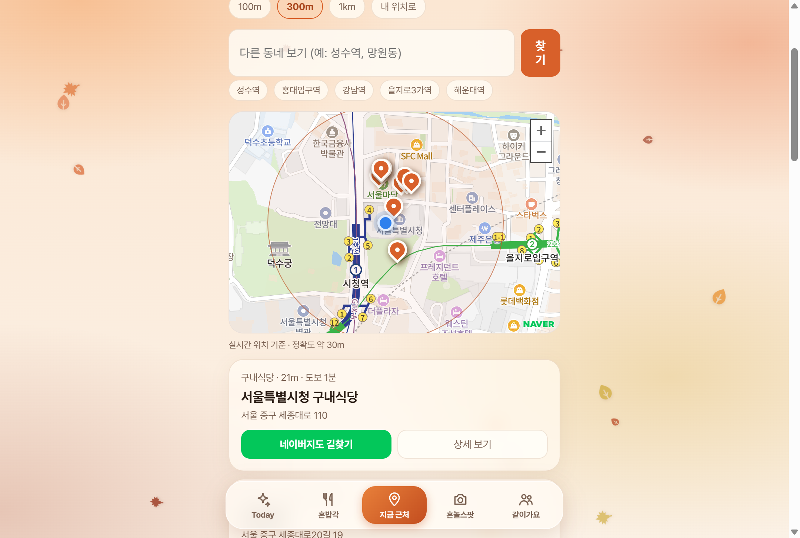

# WAYALONE

[](https://github.com/SeokBeom0709/wayalone/actions/workflows/ci.yml)

혼자 밥 먹기 좋은 식당을 내 위치 기준으로 찾고, 혼자 가기 애매한 식사·여행은 검증된 사람과 함께하는 서비스입니다.

- 포트폴리오: [docs/PORTFOLIO.md](docs/PORTFOLIO.md)
- 설계 노트: [docs/DESIGN.md](docs/DESIGN.md) / 트러블슈팅: [docs/TROUBLESHOOTING.md](docs/TROUBLESHOOTING.md)
- 성능·동시성 개선 기록(측정값): [docs/PERFORMANCE.md](docs/PERFORMANCE.md)
- 스택: Java 17 · Spring Boot 4.1 · Spring Data JPA · H2/MySQL · Vanilla JS · 네이버 지도 · 카카오 로컬 API



## 빠른 실행 (H2, 설치할 DB 없음)

필요한 것: **JDK 17**, Git

```bash
git clone https://github.com/SeokBeom0709/wayalone.git
cd wayalone
./gradlew bootRun          # Windows: .\gradlew.bat bootRun
```

`http://localhost:8080`에 접속하면 됩니다. 처음 실행할 때 Gradle을 내려받느라 몇 분 걸릴 수 있습니다.

- **회원가입**: 개발 모드에서는 문자가 실제로 발송되지 않고, 인증번호가 화면에 표시됩니다. 그대로 입력하면 됩니다.
- **관리자 화면**: `http://localhost:8080/#/admin` / 계정 `admin@wayalone.test`, 비밀번호 `Admin1234!` (개발용 기본값, 운영에서는 환경변수로 교체)
- **주변 식당**: 카카오 REST 키가 있어야 동작합니다. 키 없이도 나머지 기능(같이가요, 회원, 관리자)은 모두 동작합니다.
  1. [카카오 디벨로퍼스](https://developers.kakao.com)에서 앱을 만들고, 앱 설정에서 **카카오맵 사용 설정을 ON**으로 바꿉니다.
  2. 앱 키 중 **REST API 키**를 복사합니다.
  3. `KAKAO_REST_KEY=키값` 환경변수를 지정하고 실행합니다. (PowerShell: `$env:KAKAO_REST_KEY="키값"; .\gradlew.bat bootRun`)

테스트

```bash
./gradlew test             # 테스트 68개. 외부 키 없이 실행됩니다 (Redis 테스트 9개는 Redis가 없으면 건너뜀)
```

Redis 테스트까지 실행하려면 `docker compose up -d redis` 후 `.env`의 `REDIS_PASSWORD` 값을 `REDIS_TEST_PASSWORD` 환경변수로 넘기세요. (PowerShell: `$env:REDIS_TEST_PASSWORD="값"; .\gradlew.bat test`)

## MySQL로 실행하려면

`.env.example`을 `.env`로 복사해 값을 채우고 `docker compose up -d`로 DB를 띄운 뒤, Windows에서는 `run-prod-local.ps1`을 실행합니다. 이 스크립트는 `prod` 프로필과 포트 8081을 사용하며, 관리자 계정은 `admin` / `admin`으로 만들어집니다(로컬 전용). 인증번호와 1회용 토큰은 `docker compose`가 함께 띄우는 Redis에 저장합니다(`VERIFICATION_STORE=db`로 두면 Redis 없이 DB에 저장).

## 환경변수

| 이름 | 필수 | 설명 |
|---|---|---|
| `KAKAO_REST_KEY` | 주변 식당 기능 사용 시 | 카카오 디벨로퍼스 REST API 키 (카카오맵 사용 설정 ON) |
| `SMS_PROVIDER` | | `log`(기본, 개발용 문자함) / `solapi`(실제 발송) |
| `SOLAPI_API_KEY`, `SOLAPI_API_SECRET`, `SMS_FROM` | `solapi`일 때 | 솔라피 키와 사전 등록된 발신번호 |
| `PHONE_PEPPER` | 운영 필수 | 휴대폰 번호 HMAC 비밀값 |
| `ADMIN_EMAIL`, `ADMIN_PASSWORD` | 운영 필수 | 시작 시 생성되는 관리자 계정 |
| `DB_URL`, `DB_USERNAME`, `DB_PASSWORD`, `CORS_ORIGINS` | 운영(`prod`) | MySQL 접속 정보, 허용 출처 |
| `VERIFICATION_STORE` | | 인증번호·1회용 토큰 저장소: `db`(기본) / `redis` |
| `REDIS_HOST`, `REDIS_PORT`, `REDIS_PASSWORD` | `redis`일 때 | Redis 접속 정보 |

네이버 지도 Client ID는 `static/js/app.js`의 `NAVER_MAP_CLIENT_ID`에 있으며, 네이버 클라우드 콘솔에서 **Web 서비스 URL**에 접속 주소를 등록해야 합니다. 등록하지 않은 주소에서는 OpenStreetMap으로 자동 전환됩니다.

## 개발용 계정 (로컬 전용)

| 실행 방법 | 관리자 계정 |
|---|---|
| `./gradlew bootRun` | `admin@wayalone.test` / `Admin1234!` |
| `start-server.bat`, `run-prod-local.ps1` | `admin` / `admin` |

공개 환경에서는 반드시 `ADMIN_EMAIL`, `ADMIN_PASSWORD`를 다른 값으로 지정하세요. 개발 모드의 인증번호는 `#/dev/sms`(개발용 문자함)에서도 볼 수 있습니다.

## 배포 (Docker)

```bash
docker build -t wayalone .
docker run -p 8080:8080 -e SPRING_PROFILES_ACTIVE=prod \
  -e DB_URL=... -e DB_USERNAME=... -e DB_PASSWORD=... \
  -e KAKAO_REST_KEY=... -e PHONE_PEPPER=... \
  -e ADMIN_EMAIL=... -e ADMIN_PASSWORD=... wayalone
```
