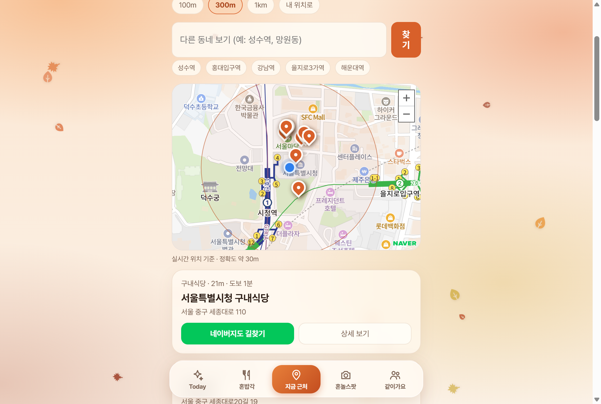
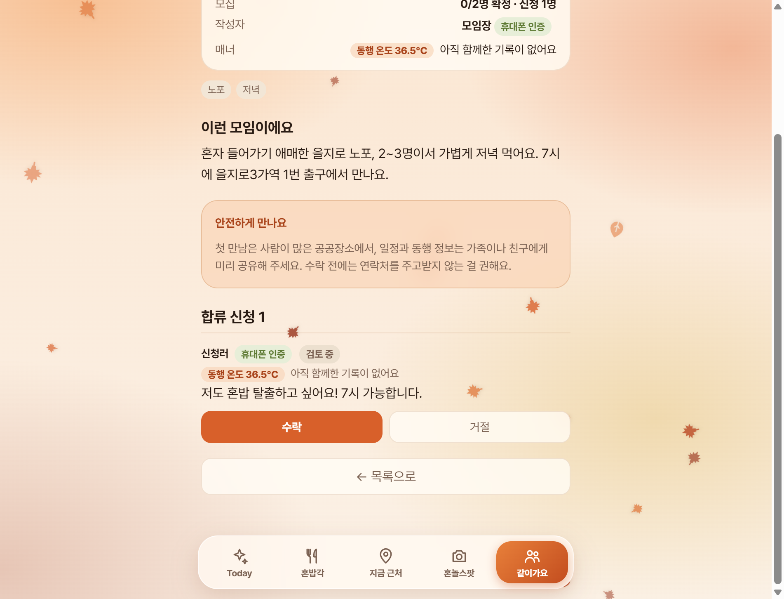
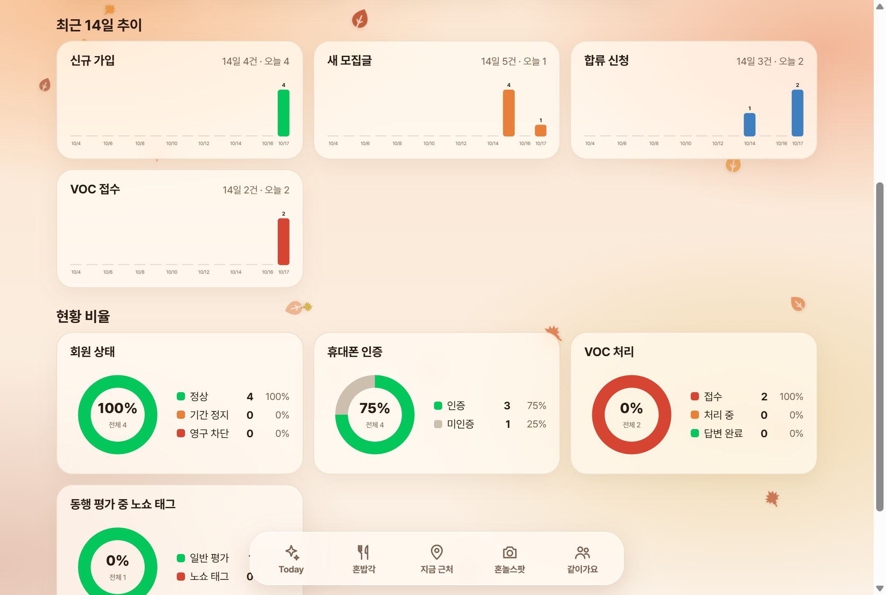
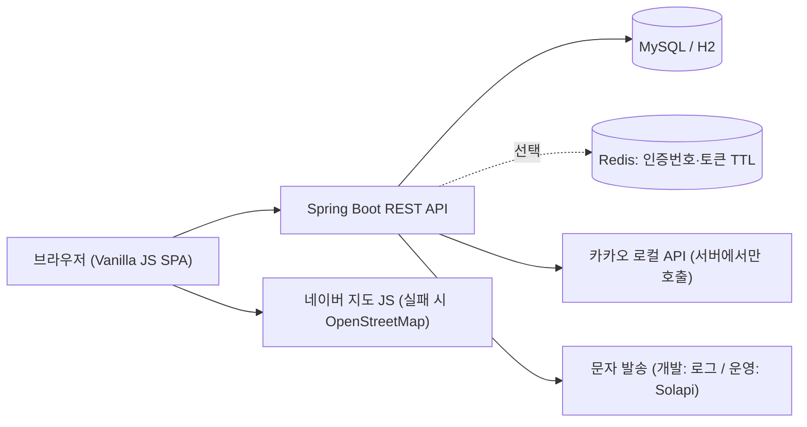

# WAYALONE

[](https://github.com/SeokBeom0709/wayalone/actions/workflows/ci.yml)

혼자 밥 먹기 좋은 식당을 내 위치 기준으로 찾고, 혼자 가기 애매한 식사·여행은 검증된 사람과 함께하는 웹 서비스입니다. 기획부터 백엔드, 프론트엔드, 관리자 도구, 테스트까지 혼자 만들었습니다.

| | |
|---|---|
| 기간 | 2026.10 ~ (1인 개발) |
| 스택 | Java 17 · Spring Boot 4.1 · Spring Data JPA · MySQL(운영) / H2(개발) · Redis(선택) · Vanilla JS · 네이버 지도 · 카카오 로컬 API |
| 규모 | REST API 44개 · 엔티티 15개 · 테스트 68개 · GitHub Actions CI |
| 데모 | 아직 배포하지 않았습니다. 아래 "빠른 실행"으로 로컬에서 바로 실행됩니다. |

| 내 주변 식당 | 같이가요 | 관리자 대시보드 |
|---|---|---|
|  |  |  |

## 주요 기능

- **사용자**: 내 위치 기준 주변 식당(100m / 300m / 1km)과 길찾기, 휴대폰 인증 가입, 동행 모집·신청·수락/거절, 모임 후 평가로 쌓이는 "동행 온도", 신고·문의·차단, 회원 탈퇴
- **운영자**: 대시보드, 회원 검색과 상세, 기간 정지/영구 차단, 문의 답변, 모집글 숨김, 처리 이력 보존과 되돌리기

## 기술적으로 신경 쓴 부분

직접 측정한 값은 [docs/PERFORMANCE.md](docs/PERFORMANCE.md)에 방법과 한계까지 적었습니다.

| 주제 | 내용 | 결과 |
|---|---|---|
| 반경 검색 | 좌표 사각형으로 후보를 줄인 뒤 Haversine 계산. `EXPLAIN`으로 전체 스캔을 확인하고 (위도, 경도) 복합 인덱스 적용. 위도 단일 인덱스는 오히려 느렸고 SPATIAL 인덱스도 비교 | 100만 행(합성 데이터), 서울 1km 조회 629ms → 5.7ms |
| N+1 | Hibernate 통계로 SQL 개수를 세는 테스트를 만들어 재현, 배치 조회로 수정 | 장소 10개 조회 SQL 31개 → 3개 |
| 인증 동시성 | 같은 인증 토큰이 동시 요청에서 여러 번 성공하는 경쟁 상태를 테스트로 재현하고, 조건부 `UPDATE`(DB)와 Redis(TTL + Lua 스크립트) 두 방식으로 수정. 같은 테스트를 두 구현에 적용 | 동시 24요청에서 토큰이 10번 성공하던 문제 해소 |
| 개인정보 | 휴대폰 번호는 HMAC 해시만, 로그인 토큰은 SHA-256 해시만 저장. 탈퇴는 삭제가 아니라 비식별화 | |
| 운영 이력 | 관리자 처리마다 직전 상태를 함께 저장하고, 되돌리면 이전 상태 복구 + 기록을 새로 남김 | |
| 외부 장애 대비 | 지도 엔진을 인터페이스 뒤에 두고 네이버 인증이 실패하면 OpenStreetMap으로 전환. 카카오 키는 서버에서만 사용 | |

설계 결정과 대안은 [docs/DESIGN.md](docs/DESIGN.md), 개발 중 겪은 문제와 해결은 [docs/TROUBLESHOOTING.md](docs/TROUBLESHOOTING.md), 프로젝트 전체 소개는 [docs/PORTFOLIO.md](docs/PORTFOLIO.md)에 있습니다.

## 구조



## 한계

- 배포하지 않았고 로컬(H2, Docker MySQL·Redis)에서만 실행해 봤습니다.
- 반경 검색 수치는 직접 만든 합성 데이터 기준이며 초당 처리량(부하) 테스트는 하지 않았습니다.
- 실제 문자 발송(Solapi)은 연동 코드만 있고 실서비스로 시험하지 않았습니다.
- 운영 DB 스키마는 아직 `ddl-auto=update`이며 Flyway로 바꿀 예정입니다. 자세한 내용은 [docs/PORTFOLIO.md](docs/PORTFOLIO.md)의 "한계와 다음 계획"에 있습니다.

---

## 빠른 실행 (H2, 설치할 DB 없음)

필요한 것: **JDK 17**, Git

```bash
git clone https://github.com/SeokBeom0709/wayalone.git
cd wayalone
./gradlew bootRun          # Windows: .\gradlew.bat bootRun
```

`http://localhost:8080`에 접속하면 됩니다. 처음 실행할 때 Gradle을 내려받느라 몇 분 걸릴 수 있습니다.

- **회원가입**: 개발 모드에서는 문자가 실제로 발송되지 않고, 인증번호가 화면에 표시됩니다. 그대로 입력하면 됩니다.
- **관리자 화면**: `http://localhost:8080/#/admin` / 계정 `admin@wayalone.test`, 비밀번호 `Admin1234!` (개발용 기본값, 운영에서는 환경변수로 교체)
- **주변 식당**: 카카오 REST 키가 있어야 동작합니다. 키 없이도 나머지 기능(같이가요, 회원, 관리자)은 모두 동작합니다.
  1. [카카오 디벨로퍼스](https://developers.kakao.com)에서 앱을 만들고, 앱 설정에서 **카카오맵 사용 설정을 ON**으로 바꿉니다.
  2. 앱 키 중 **REST API 키**를 복사합니다.
  3. `KAKAO_REST_KEY=키값` 환경변수를 지정하고 실행합니다. (PowerShell: `$env:KAKAO_REST_KEY="키값"; .\gradlew.bat bootRun`)

IDE(STS, Eclipse)에서 실행할 때는 **Lombok 설치가 필요**합니다. 설치 없이 실행하려면 Gradle 작업 `bootRun`으로 실행하세요.

## 테스트

```bash
./gradlew test             # 테스트 68개. 외부 키 없이 실행됩니다 (Redis 테스트 9개는 Redis가 없으면 건너뜀)
```

Redis 테스트까지 실행하려면 `docker compose up -d redis` 후 `.env`의 `REDIS_PASSWORD` 값을 `REDIS_TEST_PASSWORD` 환경변수로 넘기세요. (PowerShell: `$env:REDIS_TEST_PASSWORD="값"; .\gradlew.bat test`)

## MySQL로 실행하려면

`.env.example`을 `.env`로 복사해 값을 채우고 `docker compose up -d`로 DB를 띄운 뒤, Windows에서는 `run-prod-local.ps1`을 실행합니다. 이 스크립트는 `prod` 프로필과 포트 8081을 사용하며, 관리자 계정은 `admin` / `admin`으로 만들어집니다(로컬 전용). 인증번호와 1회용 토큰은 `docker compose`가 함께 띄우는 Redis에 저장합니다(`VERIFICATION_STORE=db`로 두면 Redis 없이 DB에 저장).

## 환경변수

| 이름 | 필수 | 설명 |
|---|---|---|
| `KAKAO_REST_KEY` | 주변 식당 기능 사용 시 | 카카오 디벨로퍼스 REST API 키 (카카오맵 사용 설정 ON) |
| `SMS_PROVIDER` | | `log`(기본, 개발용 문자함) / `solapi`(실제 발송) |
| `SOLAPI_API_KEY`, `SOLAPI_API_SECRET`, `SMS_FROM` | `solapi`일 때 | 솔라피 키와 사전 등록된 발신번호 |
| `PHONE_PEPPER` | 운영 필수 | 휴대폰 번호 HMAC 비밀값 |
| `ADMIN_EMAIL`, `ADMIN_PASSWORD` | 운영 필수 | 시작 시 생성되는 관리자 계정 |
| `DB_URL`, `DB_USERNAME`, `DB_PASSWORD`, `CORS_ORIGINS` | 운영(`prod`) | MySQL 접속 정보, 허용 출처 |
| `VERIFICATION_STORE` | | 인증번호·1회용 토큰 저장소: `db`(기본) / `redis` |
| `REDIS_HOST`, `REDIS_PORT`, `REDIS_PASSWORD` | `redis`일 때 | Redis 접속 정보 |

네이버 지도 Client ID는 `static/js/app.js`의 `NAVER_MAP_CLIENT_ID`에 있으며, 네이버 클라우드 콘솔에서 **Web 서비스 URL**에 접속 주소를 등록해야 합니다. 등록하지 않은 주소에서는 OpenStreetMap으로 자동 전환됩니다.

## 개발용 계정 (로컬 전용)

| 실행 방법 | 관리자 계정 |
|---|---|
| `./gradlew bootRun` | `admin@wayalone.test` / `Admin1234!` |
| `start-server.bat`, `run-prod-local.ps1` | `admin` / `admin` |

공개 환경에서는 반드시 `ADMIN_EMAIL`, `ADMIN_PASSWORD`를 다른 값으로 지정하세요. 개발 모드의 인증번호는 `#/dev/sms`(개발용 문자함)에서도 볼 수 있습니다.

## 배포 (Docker)

```bash
docker build -t wayalone .
docker run -p 8080:8080 -e SPRING_PROFILES_ACTIVE=prod \
  -e DB_URL=... -e DB_USERNAME=... -e DB_PASSWORD=... \
  -e KAKAO_REST_KEY=... -e PHONE_PEPPER=... \
  -e ADMIN_EMAIL=... -e ADMIN_PASSWORD=... wayalone
```
