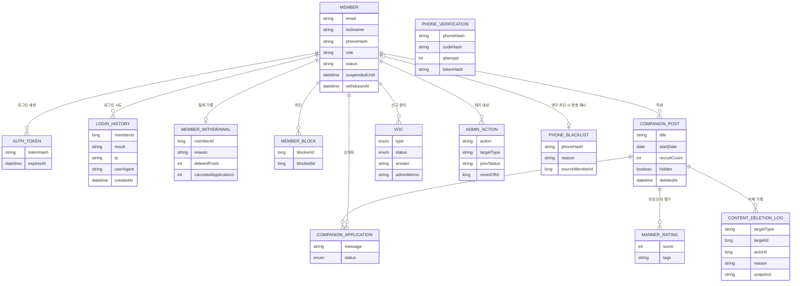

# 설계 노트

## 데이터 모델

회원과 모집글은 행을 지우지 않고 상태(`WITHDRAWN`, `deletedAt`)로 처리합니다. 표에 나온 `PHONE_VERIFICATION`은 가입 전 단계라 회원과 연결되지 않습니다.

## 설계 결정

### 1. 휴대폰 번호와 인증번호
- 중복 가입을 막는 데 필요한 것은 "이미 있는 번호인가"뿐이라 원문은 저장하지 않습니다. 그냥 SHA-256은 번호 공간이 작아 역산할 수 있어서 서버 비밀값(pepper)을 쓰는 HMAC-SHA256을 씁니다.
- 인증번호도 해시로 저장하고 `MessageDigest.isEqual`로 비교합니다.
- 제한: 3분 만료, 5회 오입력 시 폐기, 번호당 1분 간격·하루 5회, IP당 시간 30회.
- 인증에 성공하면 30분짜리 1회용 토큰을 주고, 회원가입 트랜잭션 안에서 사용 처리합니다. 가입이 실패하면 사용 처리도 같이 되돌려집니다.
- 발송기는 `SmsSender` 인터페이스로 분리해서 개발(로그)과 운영(Solapi)을 설정으로 바꿉니다. 운영에서는 인증번호가 응답에 담기지 않습니다.

### 2. 로그인 토큰과 계정 보안
- 256비트 랜덤 토큰을 발급하고 DB에는 SHA-256 해시만 둡니다. 로그아웃, 비밀번호 변경, 제재 때 즉시 폐기해야 해서 JWT 대신 서버 저장형을 택했습니다.
- 비밀번호는 BCrypt. 같은 이메일로 5번 실패하면 10분 잠급니다. 없는 이메일도 더미 해시와 비교해서 응답 시간으로 계정 존재 여부를 알 수 없게 했습니다.
- 운영진으로 오해할 닉네임(운영자, 관리자, admin 등)은 쓸 수 없습니다.

### 3. 동행 신청 내용은 작성자와 신청자 본인만
- 개발 중 점검에서 신청 메시지 목록이 로그인 없이 보인다는 것을 발견했습니다. 메시지에 연락처를 적을 수 있어서 작성자는 전체를, 신청자는 본인 것만 보게 바꾸고 테스트를 추가했습니다.

### 4. 동행 온도
- 처음에는 참석 여부를 필수로 묻고 참석률과 노쇼 감점을 공개했습니다. 사정이 생겨 못 갈 수도 있는데 낙인이 된다는 피드백을 받아, 공개 점수는 별점만 반영하고 노쇼는 운영자만 보는 태그로 바꿨습니다. 이미 쌓인 데이터는 그대로 해석되게 했습니다.

### 5. 관리자 처리 이력과 되돌리기
- 정지·차단·해제, 글 숨김, VOC 답변을 `admin_actions`에 남기고 기록은 수정하거나 지우지 않습니다.
- 처리할 때 직전 상태를 같이 저장해 두고, 되돌리면 이전 상태로 복구하면서 `REVERT` 기록을 새로 남깁니다.
- 같은 대상에 처리가 여러 번 있으면 가장 최근 것부터만 되돌릴 수 있습니다. 되돌리기 기록은 다시 되돌릴 수 없습니다.

### 6. 회원 탈퇴: 삭제가 아니라 비식별화
- 회원 행을 지우면 이 회원이 받은 평가, 신고, 제재 이력의 연결이 끊겨 분쟁 대응이 어렵습니다.
- 탈퇴는 한 트랜잭션에서 처리합니다.
  - 이메일과 닉네임을 `withdrawn-{id}@deleted.invalid`, `탈퇴한회원{id}`로 바꿉니다.
  - 비밀번호 해시를 무작위 값으로 바꾸고 번호 해시를 지웁니다.
  - 세션을 모두 폐기합니다.
  - 내 모집글은 삭제 기록을 남기고 삭제 처리, 답을 못 받은 신청은 취소합니다.
  - 닉네임이 글, 신청, 후기, 문의에 복사 저장돼 있어서 네 테이블을 함께 바꿉니다.
  - `member_withdrawals`에는 정리한 개수만 남기고 개인정보는 넣지 않습니다.
- 탈퇴할 때 비밀번호를 한 번 더 확인하고, 틀리면 횟수를 제한합니다.
- 영구 차단된 번호의 해시는 `phone_blacklist`에 따로 보관해서, 회원 행을 정리해도 재가입 차단이 유지됩니다. 차단을 풀거나 되돌리면 목록에서도 뺍니다.

### 7. 로그인 기록과 클라이언트 IP
- 성공/실패와 IP, User-Agent를 `login_history`에 남깁니다. 실패해도 기록이 남아야 해서 `login()`은 예외에 롤백하지 않습니다(실패 경로에는 다른 쓰기가 없음).
- 프록시 뒤에서는 `getRemoteAddr()`가 프록시 IP라 모두 같은 IP로 보입니다. `X-Forwarded-For`는 직접 연결된 곳이 사설망·루프백일 때만 믿어서 외부에서 헤더를 위조하지 못하게 했습니다.
- IP는 개인정보라 보관 기간(기본 365일)이 지나면 매일 새벽에 삭제합니다. 법적 기준은 서비스 형태에 따라 달라서 공개 전에 확인이 필요합니다.

### 8. 스키마 변경
- 컬럼은 nullable로 추가하고 엔티티에 기본값을 해석하는 메서드(`status()` 등)를 둡니다. 시작할 때 빈 값을 채웁니다.
- 상태값이 늘어나는 컬럼은 네이티브 ENUM 대신 VARCHAR로 선언했습니다([TROUBLESHOOTING.md](TROUBLESHOOTING.md) 참고).
- 운영 전환 때 Flyway로 바꿀 예정입니다.
