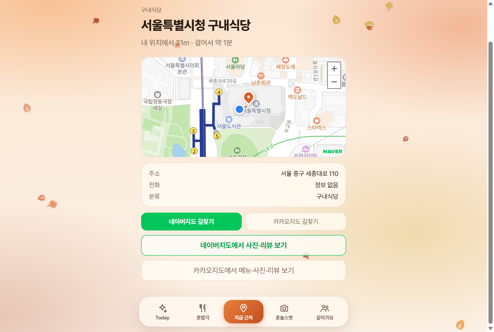
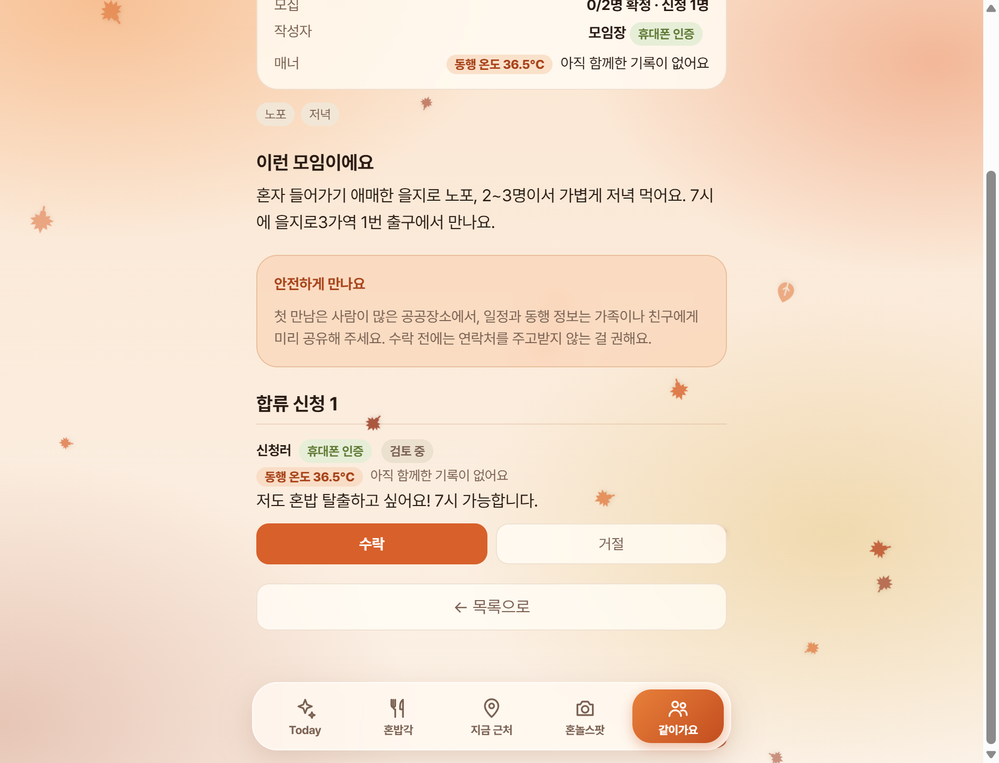
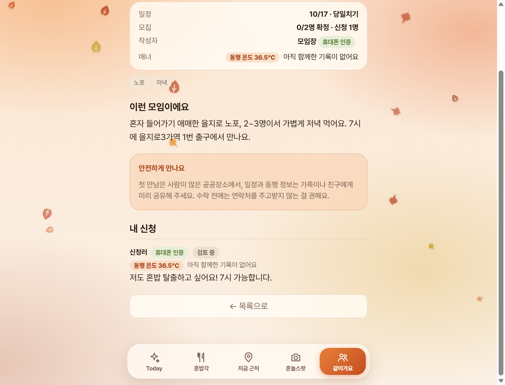
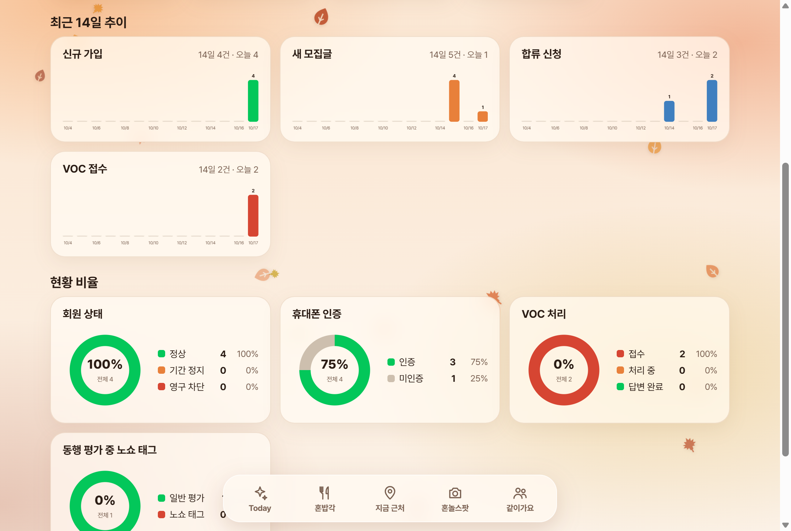
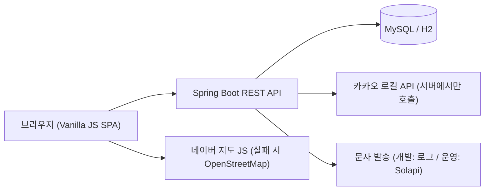

# WAYALONE

혼자 밥 먹기 좋은 식당을 내 위치 기준으로 찾고, 혼자 가기 애매한 식사·여행은 같이 갈 사람을 구할 수 있는 웹 서비스입니다.

| | |
|---|---|
| 기간 | 2026.10 ~ (1인 개발) |
| 담당 | 기획, 백엔드, 프론트엔드, 관리자 도구, 테스트 |
| 스택 | Java 17, Spring Boot 4, Spring Data JPA, MySQL(운영) / H2(개발), Vanilla JS, 네이버 지도·카카오 로컬 API |
| 규모 | REST API 44개, 엔티티 15개, 테스트 68개, 백엔드 약 5,700줄, 프론트 약 2,700줄 |
| 저장소 | https://github.com/SeokBeom0709/wayalone |
| 데모 | `배포 후 URL 기입` (현재는 로컬 실행) |

## 만든 이유

지도 앱은 맛집은 알려 주지만, 혼자 가도 편한 곳인지는 알려 주지 않습니다. 동행을 구하는 커뮤니티는 많지만 모르는 사람을 만나는 데 필요한 안전장치(본인 확인, 노쇼 관리, 신고 처리)가 약합니다. 그래서 위치 기반 식당 탐색, 안전장치가 있는 동행 모집, 이를 운영하는 관리자 도구를 한 서비스로 만들었습니다.

## 화면

| 내 주변 식당 | 식당 상세 · 길찾기 |
|---|---|
|  |  |

| 같이가요 (작성자) | 같이가요 (신청자) |
|---|---|
|  |  |

| 관리자 대시보드 |
|---|
|  |

## 구현한 것

**사용자**
- 현재 위치 기준 주변 식당(100m / 300m / 1km), 길찾기
- 휴대폰 인증 가입, 동행 모집·신청·수락/거절
- 모임 후 평가로 쌓이는 "동행 온도"
- 신고·문의, 사용자 차단, 모집글 삭제, 회원 탈퇴, 내 로그인 기록

**운영자**
- 대시보드(가입·모집글·신청·VOC 추이와 비율 차트)
- 회원 검색과 상세(평가, 신고, 로그인 기록, 탈퇴·삭제 기록)
- 기간 정지 / 영구 차단, VOC 답변, 모집글 숨김
- 처리 이력 보존과 되돌리기

## 구조

테이블 구조는 [DESIGN.md](DESIGN.md)의 ERD에 있습니다.

## 설계에서 신경 쓴 부분

자세한 이유와 대안은 [DESIGN.md](DESIGN.md)에 적었습니다.

1. **개인정보를 가능한 한 저장하지 않기.** 휴대폰 번호는 HMAC 해시로만, 로그인 토큰은 SHA-256 해시로만 저장합니다. 탈퇴하면 행을 지우지 않고 식별 정보만 비식별화합니다.
2. **관리자 처리 이력은 지우지 않기.** 처리할 때 직전 상태를 함께 저장하고, 잘못 처리했다면 "되돌리기" 기록을 새로 남기며 복구합니다.
3. **문자 인증 남용 막기.** 만료, 오입력 횟수, 재발송 간격, 번호별·IP별 한도를 두고, 인증 성공 후에는 1회용 토큰을 가입 트랜잭션 안에서 소비합니다.
4. **외부 서비스 장애에 대비하기.** 카카오 키는 서버에서만 쓰고, 지도 엔진은 공통 인터페이스 뒤에 두어 네이버 인증이 실패하면 OpenStreetMap으로 바꿉니다.

## 측정하고 고친 것

[PERFORMANCE.md](PERFORMANCE.md)에 방법과 수치, 한계를 적었습니다.

| 주제 | 결과 (합성 데이터, 로컬 PC) |
|---|---|
| 반경 검색 인덱스 | 100만 행, 서울 1km: 거리 계산만 629ms → (위도, 경도) 복합 인덱스 5.7ms. 위도 단일 인덱스는 756ms로 오히려 느림 |
| 목록 N+1 | 장소 10개 조회 시 SQL 31개 → 3개 |
| 인증 동시성 | 같은 토큰이 동시 24요청에서 10번 성공하던 문제를 재현하고 수정. DB(조건부 UPDATE)와 Redis(TTL + Lua) 두 구현에 같은 테스트 |

개발 중 겪은 문제와 해결은 [TROUBLESHOOTING.md](TROUBLESHOOTING.md)에 정리했습니다.

## 테스트

`@SpringBootTest`로 서버를 실제 포트에 띄우고 HTTP로 호출합니다. 클래스마다 독립된 H2 메모리 DB를 씁니다. 권한, 개인정보 노출, 상태 변화(정지, 탈퇴, 차단, 되돌리기)처럼 틀리면 피해가 큰 부분을 중심으로 작성했고, 동시 요청 테스트와 SQL 개수 테스트도 있습니다. Redis 테스트는 Redis가 없으면 건너뛰며, CI(GitHub Actions)에서는 Redis를 띄워 실행합니다.

## 한계와 다음 계획

- 아직 배포하지 않았고, 로컬에서 H2와 Docker MySQL로만 실행해 봤습니다.
- 운영 DB 스키마는 아직 `ddl-auto=update`입니다. Flyway로 바꿀 예정입니다.
- 문자 인증 쪽 IP 한도는 Redis로 옮길 수 있게 했지만(`app.verification.store=redis`), 로그인 실패 잠금(`LoginAttemptLimiter`)은 아직 서버 메모리라 서버를 여러 대로 늘리면 공유되지 않습니다.
- 반경 검색은 합성 데이터로만 측정했고, 서비스의 실제 장소 데이터는 아직 적습니다. 부하 테스트(초당 요청 수)는 하지 않았습니다.
- 실제 문자 발송(Solapi)은 연동 코드만 있고 실서비스로 시험하지 않았습니다.
